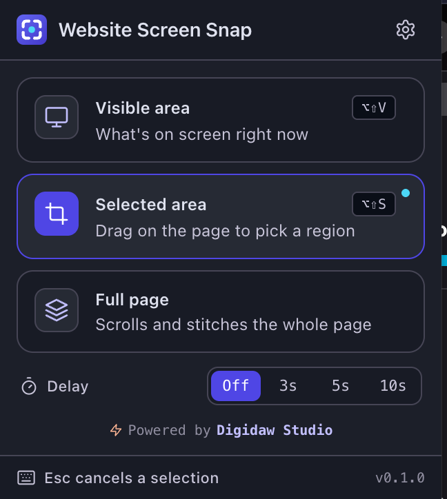
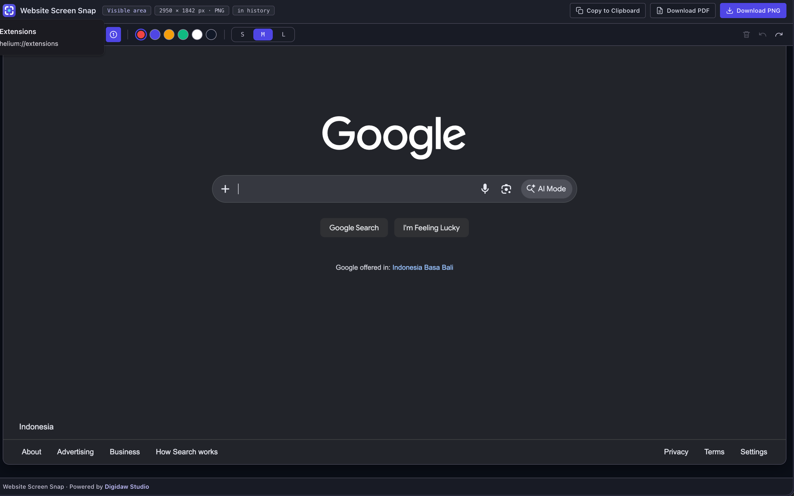
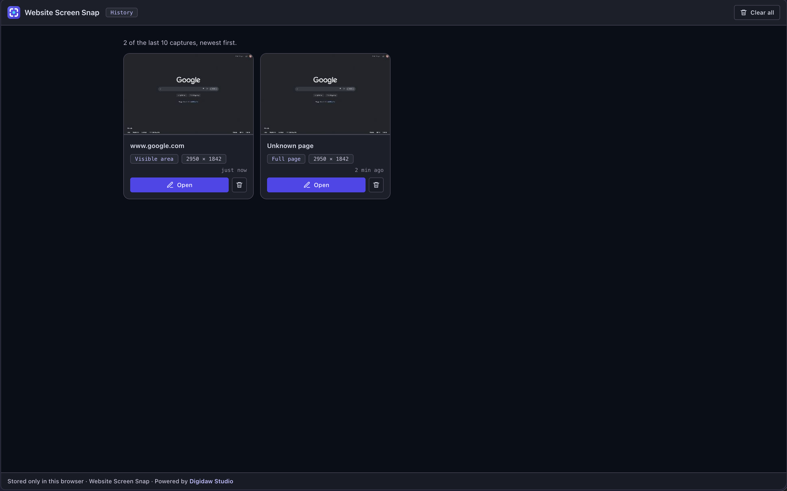
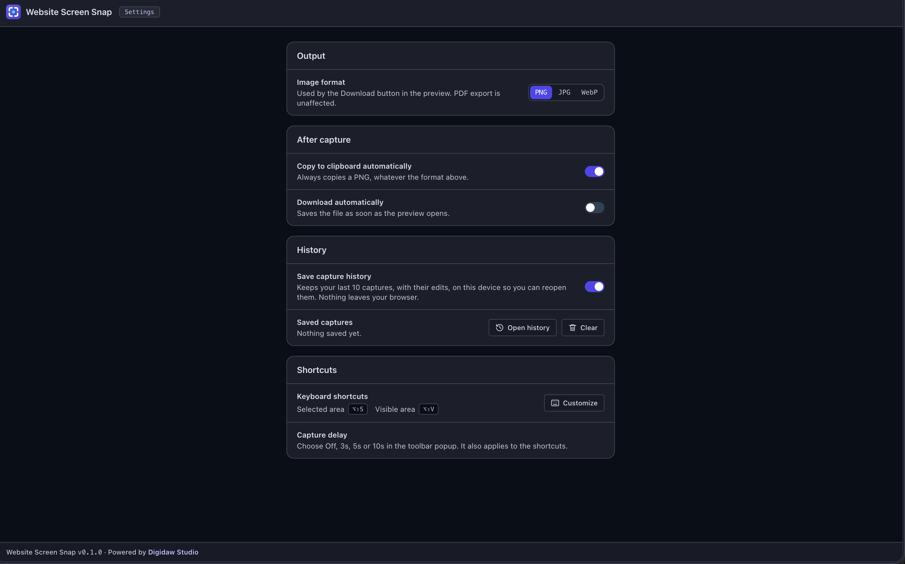

# Website Screen Snap

Extension Chrome (Manifest V3) untuk screenshot website: **visible area**, **selected area**, dan **full page**. Hasilnya langsung bisa diedit (crop, blur, panah, teks, nomor langkah), lalu disalin, diunduh sebagai PNG/JPG/WebP, atau diekspor ke PDF.

Dibuat oleh [Digidaw Studio](https://digidaw.web.id). Versi saat ini: **0.1.0**.

<p align="center">
  
</p>

---

## Latar belakang

Screenshot sering jadi pekerjaan dua tahap: ambil gambarnya, lalu buka aplikasi lain untuk memberi tanda, menutup data sensitif, atau memotong. Untuk halaman panjang ada tahap tambahan: menyambung beberapa tangkapan layar secara manual.

Website Screen Snap menyatukan alur itu di dalam browser:

1. **Ambil** halaman dengan tiga mode (yang terlihat, area yang dipilih, atau seluruh halaman yang di-scroll dan disambung otomatis).
2. **Edit** di tab preview: crop, pixelate area sensitif, tambahkan panah, kotak, teks, dan penanda bernomor.
3. **Keluarkan** hasilnya: salin ke clipboard, unduh sebagai gambar, atau ekspor ke PDF.

Beberapa prinsip yang dipegang sejak awal:

- **Ringan.** JavaScript biasa, tanpa build step dan tanpa dependency. Generator PDF-nya pun ditulis sendiri (sekitar 90 baris).
- **Izin seminimal mungkin.** Tidak meminta akses ke semua situs (tanpa host permission). Extension hanya bekerja di tab yang kamu klik atau yang kamu beri shortcut.
- **Privasi.** Tidak ada server dan tidak ada yang dikirim lewat jaringan. Gambar, editan, dan riwayat hanya tersimpan di browser kamu.
- **Non-destruktif.** Gambar asli tidak pernah diubah. Editan disimpan sebagai lapisan di atasnya, jadi selalu bisa di-undo, digeser, atau dihapus.

---

## Fitur

### Tiga mode capture

| Mode | Yang diambil | Cara memicu |
|---|---|---|
| **Visible area** | Persis yang sedang terlihat di layar | Kartu di popup, atau `Alt+Shift+V` (`⌥⇧V` di Mac) |
| **Selected area** | Persegi yang kamu seret di halaman. `Esc` untuk batal | Kartu di popup, atau `Alt+Shift+S` (`⌥⇧S` di Mac) |
| **Full page** | Seluruh halaman: di-scroll otomatis lalu disambung jadi satu gambar | Kartu di popup |

Ada juga **delay timer** (Off / 3s / 5s / 10s) di popup, supaya menu dropdown, tooltip, atau state hover sempat dibuka sebelum diambil. Hitung mundurnya tampil di badge icon extension, bukan di halaman, jadi tidak ikut ke-capture.

### Editor di tab preview

Setiap capture terbuka di tab preview dengan toolbar editor.

<p align="center">
  
</p>

| Tool | Tombol | Fungsi |
|---|---|---|
| Select | `V` | Pilih, geser, ganti warna, atau hapus anotasi yang sudah dibuat |
| Crop | `C` | Seret area yang dipertahankan; sisanya tidak ikut ke hasil |
| Blur | `B` | Pixelate area yang diseret sehingga teks di bawahnya tidak terbaca |
| Rectangle | `R` | Kotak outline |
| Arrow | `A` | Panah dari ekor ke kepala |
| Text | `T` | Klik, ketik, tekan Enter |
| Step | `N` | Penanda bernomor; nomornya naik dan menyesuaikan otomatis saat ada yang dihapus |

Pilih warna (merah, indigo, kuning, hijau, putih, hitam) dan ukuran (S/M/L) di toolbar. **Undo/Redo**: `Ctrl/Cmd+Z` dan `Ctrl/Cmd+Shift+Z`. **Hapus** anotasi terpilih: `Delete`. `Esc` melepas tool yang aktif.

> **Blur itu pixelate** dan permanen setelah diekspor. Untuk data sensitif, tutup area yang sedikit lebih besar dari teksnya.

### Keluaran

- **Copy to Clipboard**: selalu PNG, apa pun format yang dipilih.
- **Download PNG / JPG / WebP**: sesuai pengaturan format (dan kualitas untuk JPG/WebP).
- **Download PDF**: satu halaman yang ukurannya mengikuti screenshot, jadi halaman panjang tidak terpotong. Isinya gambar saja, jadi teksnya tidak bisa diseleksi atau dicari.

Semua keluaran sudah memuat editan terbaru.

### Riwayat

Last 10 capture disimpan beserta editannya, supaya bisa dibuka lagi dan diedit walaupun tab preview sudah ditutup. Buka lewat ikon jam di popup.

<p align="center">
  
</p>

Riwayat bisa dimatikan di Settings, dan bisa dihapus satu per satu atau semuanya. Datanya tersimpan di IndexedDB browser kamu dan tidak dikirim ke mana pun.

### Pengaturan

Buka lewat ikon gear di popup. Perubahan tersimpan otomatis.

<p align="center">
  
</p>

- **Image format**: PNG, JPG, atau WebP, plus slider kualitas (50 sampai 100%) untuk JPG dan WebP.
- **Copy to clipboard automatically** dan **Download automatically**: dijalankan begitu preview dari capture baru terbuka. Membuka ulang dari riwayat tidak memicunya.
- **Save capture history**: hidupkan atau matikan riwayat.
- **Shortcuts**: menampilkan tombol yang benar-benar terpasang, dengan tombol untuk mengubahnya.

---

## Cara pasang

Extension ini belum ada di Chrome Web Store, jadi dipasang dari foldernya (mode developer). Tidak perlu build atau install apa pun.

**Syarat:** Chrome atau browser berbasis Chromium yang mendukung Manifest V3 (Brave, Edge, dan sejenisnya), versi yang masih diperbarui.

1. **Unduh project ini** (clone repo, atau unduh ZIP lalu ekstrak) sehingga kamu punya satu folder yang berisi `manifest.json`.
2. Buka halaman extension di browser:
   - Chrome: `chrome://extensions`
   - Brave: `brave://extensions`
   - Edge: `edge://extensions`
3. Nyalakan **Developer mode** (pojok kanan atas).
4. Klik **Load unpacked**, lalu pilih folder project (folder yang berisi `manifest.json`, bukan folder induknya).
5. **Pin** extension lewat ikon puzzle di toolbar supaya mudah dijangkau.

Setelah itu, klik icon **Website Screen Snap** atau pakai shortcut.

### Mengubah kode atau memperbarui

Setiap kali ada file yang diubah, klik **Reload** pada kartu extension di halaman extension, lalu **refresh tab** yang mau di-capture supaya content script dimuat ulang.

### Mengubah shortcut

Buka **Settings → Shortcuts → Customize** (atau langsung ke `chrome://extensions/shortcuts`). Default-nya `Alt+Shift+S` (selected area) dan `Alt+Shift+V` (visible area).

---

## Izin yang diminta

| Izin | Untuk apa |
|---|---|
| `activeTab` | Mengambil tab yang sedang aktif setelah kamu klik icon atau pakai shortcut, tanpa akses luas ke situs |
| `scripting` | Memasukkan content script ke tab aktif (overlay seleksi, scroll, menyembunyikan bar sticky) |
| `storage` | Menyimpan pengaturan dan pilihan delay |
| `clipboardWrite` | Supaya Auto-copy bisa menulis ke clipboard tanpa perlu klik |

Tidak ada host permission, dan tidak ada permintaan jaringan.

---

## Cara kerja singkat

Service worker menjadi pusatnya: popup dan shortcut memberi tahu apa yang harus diambil, worker mengatur halaman dan API screenshot Chrome, lalu hasilnya diserahkan ke tab preview.

```
Popup / Shortcut ──▶ Service worker ◀──▶ Content script (di dalam website)
                          │
                          ├──▶ chrome.tabs.captureVisibleTab
                          │
                          ▼
                     Tab preview (gabungkan gambar, editor, Copy / PNG / PDF)
                          │
                          ▼
                     IndexedDB (riwayat)
```

**Full page** bekerja dengan loop: scroll satu tinggi layar, tunggu sebentar, sembunyikan elemen sticky/fixed, ambil gambar, ulangi sampai dasar halaman, lalu preview menyambung semua potongan. Beberapa detail:

- Elemen `fixed`/`sticky` dipindai ulang setelah setiap scroll, karena banyak situs baru mengubah header jadi bar tetap setelah di-scroll.
- Tinggi halaman diukur ulang di setiap langkah, jadi konten lazy-load ikut terambil (batas 80 potongan).
- Untuk aplikasi web yang scroll-nya ada di elemen dalam (bukan di `window`), terdeteksi otomatis. Header, sidebar, dan footer diambil sekali, lalu area scroll-nya yang diperpanjang.
- Chrome membatasi `captureVisibleTab` sekitar dua kali per detik, jadi setiap potongan butuh sekitar 0,7 detik.
- Canvas dibatasi 16384 px per sisi; gambar yang lebih besar otomatis diperkecil.

### Struktur folder

```
manifest.json              Manifest MV3: izin, popup, options, shortcut, ikon
background.js              Service worker: delay, orkestrasi capture, serah-terima ke preview
content.js                 Dimasukkan ke halaman: overlay seleksi, scroll, sembunyikan bar sticky
popup.html / .css / .js    Popup: kartu mode, delay, cek halaman terbatas
preview.html / .css / .js  Tab preview: gabungkan gambar, toolbar, Copy / Download / PDF
editor.js                  Editor non-destruktif (crop, blur, kotak, panah, teks, step, undo/redo)
pdf.js                     Penulis PDF satu halaman tanpa dependency
options.html / .css / .js  Halaman pengaturan
settings.js                Default, validasi, dan helper penyimpanan pengaturan
history.html / .css / .js  Halaman riwayat
history-db.js              Penyimpanan riwayat di IndexedDB (10 terakhir)
ui.css / icons.js          Design token bersama dan ikon SVG inline
icons/                     Logo (SVG) dan ikon PNG 16, 32, 48, 128 px
image/                     Screenshot untuk dokumentasi ini
design/                    Referensi desain (DESIGN.md dan mockup)
```

---

## Batasan yang diketahui

| Batasan | Dampak | Solusi sementara |
|---|---|---|
| Dua area scroll sekaligus (misalnya kolom kiri dan kanan) | Hanya area scroll terbesar yang diambil penuh | Ambil tiap sisi dengan Selected area |
| Scroll horizontal | Konten di luar lebar layar tidak disambung | Belum ada |
| Gambar lazy-load | Scroll cepat bisa mengambil placeholder | Scroll halaman sekali secara manual sebelum capture |
| Halaman terbatas (`chrome://`, Web Store, sebagian PDF viewer, `file://` tanpa izin) | Capture dinonaktifkan atau gagal | Aktifkan "Allow access to file URLs" untuk file lokal |
| Halaman sangat panjang | Gambar diperkecil agar muat batas canvas | Pakai Selected area untuk bagian yang dibutuhkan |
| PDF | Hanya berisi gambar, teks tidak bisa dicari | Pakai PNG, atau tambahkan OCR nanti |
| Blur | Berupa pixelate dan permanen setelah diekspor | Tutup area yang sedikit lebih besar dari teksnya |
| Pindah tab saat hitung mundur delay | Capture dibatalkan, badge menampilkan `ERR` | Tetap di tab yang sama sampai selesai |

### Pemecahan masalah

- **Badge `ERR` di icon:** buka kartu extension di halaman extension, klik **service worker**, lalu baca console-nya.
- **Tidak terjadi apa-apa setelah mengubah kode:** Reload extension, lalu refresh tab target.
- **Header berulang di hasil full page:** laporkan bersama situsnya, supaya deteksi elemen sticky-nya bisa diperbaiki.
- **Auto-copy gagal:** tombol Copy menampilkan "Copy failed". Detailnya ada di console tab preview.

---

## Status dan rencana

Versi 0.1.0 masih tahap awal dan dikembangkan lewat iterasi cepat. Sebagian besar alurnya sudah dicoba di browser, tetapi belum ada tes otomatis di dalam repo.

Ide pengembangan berikutnya:

- Perbaikan full page: beberapa area scroll, scroll horizontal, menunggu gambar lazy-load.
- PDF berhalaman (A4) sebagai alternatif satu halaman panjang.
- Capture elemen (hover lalu klik elemen DOM).
- Upload dan tautan berbagi (butuh backend).
- Rekam layar / GIF.
- Lokalisasi (Indonesia dan Inggris); antarmuka saat ini masih berbahasa Inggris.

Lisensi belum ditentukan.
